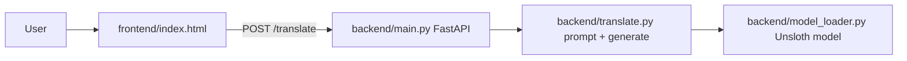

# Marma Research Assistant Translator

A web application that translates between **Bangla**, **English** and **Marma** (a low-resource language of Bangladesh), written in either English or Bangla script. A static web frontend sends text to a **FastAPI** service that runs a **fine-tuned LLaMA-3 model** (loaded with Unsloth, 4-bit) on a GPU.

Capstone project, Department of Computer Science and Engineering, February 2026.

<!-- Add after capturing screenshots (see docs/screenshots/README.md):

-->

## Features

- Translation between four language options: Bangla, English, Marma (English script), Marma (Bangla script)
- Source and target cannot be the same; one-click language swap (text is swapped too)
- Character counter, copy-to-clipboard, `Ctrl+Enter` to translate, loading spinner and error banner
- In-app user guide, team page and citation tab (BibTeX / APA / IEEE)
- REST API with automatic OpenAPI docs at `/docs`
- Model loaded once at startup and reused across requests

## Tech stack

| Layer | Technology |
|---|---|
| Frontend | Single-file HTML, vanilla JavaScript, Tailwind CSS (CDN), Inter font |
| Backend | Python, FastAPI, Uvicorn, Pydantic |
| Model | LLaMA-3 8B fine-tuned for Marma (per the service's status endpoint), Unsloth `FastLanguageModel`, 4-bit via bitsandbytes, PyTorch / Transformers |
| Hosting used in development | Google Colab GPU + Google Drive for weights, ngrok tunnel |
| Tooling | pytest, GitHub Actions |

## Architecture



Details in [docs/architecture.md](docs/architecture.md).

## Repository structure

```
marma-translator/
├── backend/
│   ├── main.py              # FastAPI app, /translate endpoint, startup model load
│   ├── model_loader.py      # Unsloth model/tokenizer singleton
│   ├── translate.py         # Alpaca prompt + generation + output cleanup
│   ├── requirements.txt     # runtime dependencies (GPU)
│   ├── requirements-test.txt
│   ├── tests/               # HTTP-layer tests (no GPU needed)
│   └── prototype/           # earlier dummy-router version, kept for reference
├── frontend/
│   ├── index.html
│   └── config.js            # backend URL
├── notebooks/
│   └── serve_backend_colab.ipynb   # run the backend on Colab behind ngrok
├── docs/
├── .env.example
└── .github/workflows/ci.yml
```

Not included: the fine-tuned model weights, the training data and the training notebook.

## Getting started

### Prerequisites

- Python 3.10+ (CI uses 3.12)
- An **NVIDIA GPU with CUDA** to run the real model (`translate.py` moves inputs to `"cuda"` and the model loads in 4-bit)
- The fine-tuned model folder (not distributed here)

### 1. Backend

```bash
cd backend
python -m venv .venv && source .venv/bin/activate
pip install -r requirements.txt
export MODEL_PATH=/path/to/fine_tuned_model     # see .env.example
uvicorn main:app --host 0.0.0.0 --port 8000
```

Check it: `curl http://localhost:8000/` → `{"status":"online","model":"LLaMA-3-8B (Marma Fine-tuned)"}`. Interactive docs: <http://localhost:8000/docs>.

### 2. Frontend

```bash
cd frontend
python -m http.server 3000
```

Open <http://localhost:3000>. The page calls the URL in `frontend/config.js` (default `http://localhost:8000/translate`).

### Running on Google Colab (how the project was demoed)

1. Copy `backend/` to `MyDrive/Marma_Backend/` and put the model folder on Drive.
2. Add an `NGROK_AUTH_TOKEN` secret in Colab.
3. Run `notebooks/serve_backend_colab.ipynb` top to bottom (set `MODEL_PATH` in the notebook).
4. Paste the printed `https://…ngrok-free.app/translate` URL into `frontend/config.js`.

## API

| Method | Path | Description |
|---|---|---|
| GET | `/` | Health check and model label |
| POST | `/translate` | Translate text |

```bash
curl -X POST http://localhost:8000/translate \
  -H "Content-Type: application/json" \
  -d '{"text": "Hello", "source_lang": "English", "target_lang": "Bangla"}'
```

```json
{"translated_text": "…", "source_lang": "English", "target_lang": "Bangla"}
```

Errors: `400` empty text, `422` invalid body, `500` inference failure. More in [docs/api.md](docs/api.md).

## Tests

```bash
cd backend
pip install -r requirements-test.txt
pytest -q
```

The tests cover the HTTP layer and the prompt template with `torch`/`unsloth` stubbed out. They do **not** test translation quality or GPU inference.

## Known limitations

- Needs a CUDA GPU; there is no CPU fallback.
- Translation quality has not been evaluated in this repository (no BLEU/chrF or other metrics are included).
- `frontend/config.js` must be edited whenever the ngrok URL changes (free tunnels rotate).
- CORS currently allows all origins; restrict it before any public deployment.
- No authentication or rate limiting.
- Generation uses `use_cache=False`, which is slow; it was added as a workaround for a tensor-shape error.

## Authors

| Name | Role (as listed in the app) |
|---|---|
| MD Mahedul Hasan Mahe | Lead Full-Stack Developer: frontend architecture, FastAPI backend, integration and deployment |
| Sumaiya Afroz Sayka | AI & Model Researcher: dataset curation, model fine-tuning, Marma tokenizer work |
| Meherunessa Ritu | AI & Model Researcher: dataset curation, model fine-tuning, Marma tokenizer work |
| Amena Akter | Backend Engineer: API integration support, stability testing |

Supervisor: Md Kaviul Hossain, Lecturer, Department of CSE.

## Citation

BibTeX, APA and IEEE entries are in the app's **Citation** tab.

## License

No license file has been chosen yet. The app states the work is for academic and research use. See the repository owner before reusing it.
