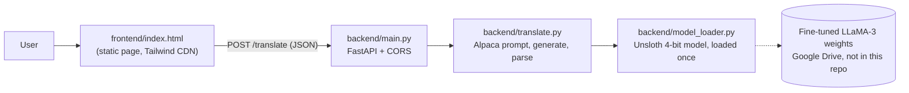

# Architecture

## Request flow

1. The user picks a source and target language (Bangla, English, Marma in English script, Marma in Bangla script) and enters text. The page blocks identical source/target.
2. `index.html` sends `{text, source_lang, target_lang}` to the URL in `frontend/config.js`. Spaces in language names are replaced with underscores before sending.
3. `main.py` rejects empty text (400), then calls `generate_translation`.
4. `translate.py` inserts the languages and text into an Alpaca-style instruction prompt, runs greedy decoding (`max_new_tokens=128`) on the GPU, and returns only the text after `### Response:`.
5. `model_loader.py` loads the model once at startup (`@app.on_event("startup")`) and keeps it in module-level globals.

## Deployment used by the project

The model is served from a Google Colab GPU session. `notebooks/serve_backend_colab.ipynb` mounts Drive, starts uvicorn inside the notebook and publishes it through an ngrok tunnel. The tunnel URL changes every session, so it is set in `frontend/config.js`.

## Prototype

`backend/prototype/main_dummy_router.py` is an earlier version with a per-direction model dictionary and placeholder output. It is kept for reference and is not used by the real service.
